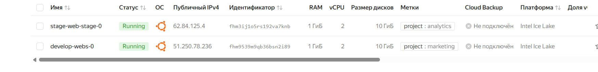
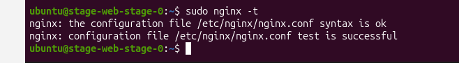
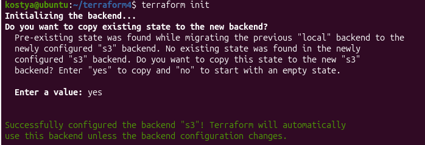
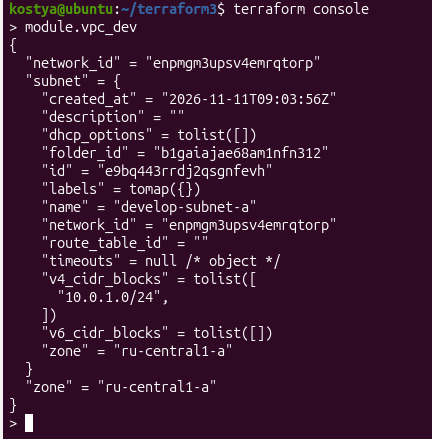
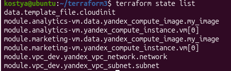
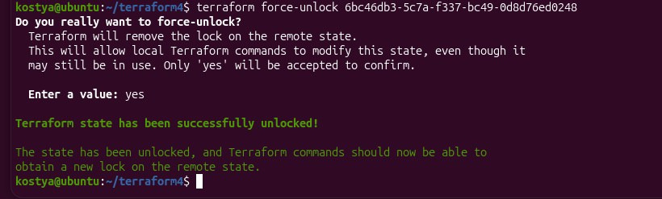
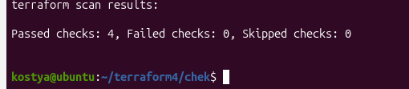
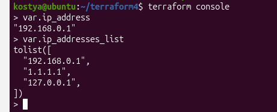
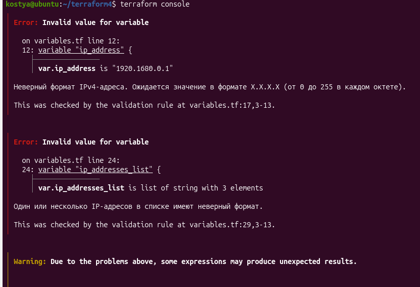

**Задание 1**

1.  Возьмите код:

- из [ДЗ к лекции 4](https://github.com/netology-code/ter-homeworks/tree/main/04/src),

- из [демо к лекции 4](https://github.com/netology-code/ter-homeworks/tree/main/04/demonstration1).

2.  Проверьте код с помощью tflint и checkov. Вам не нужно инициализировать этот проект.

3.  Перечислите, какие **типы** ошибок обнаружены в проекте (без дублей).

**Решение**

**Скачиваем папки через <https://downgit.github.io>**

**TFLint:**

**docker run --rm -v "\$(pwd):/data" -t ghcr.io/terraform-linters/tflint --recursive**



**Основные предупреждения:**

**- не указаны версии для провайдеров**

**- переменные объявлены, но не использованы**

**Checkov:**

**docker run --rm -v "\$(pwd):/tf" bridgecrew/checkov -d /tf --compact --quiet**



**Предупреждения:**

**- используйте hash коммита при указании источника модуля**

**- используйте tag с номером версии при указании источника модуля**

------------------------------------------------------------------------

**Задание 2**

1.  Возьмите ваш GitHub-репозиторий с **выполненным ДЗ 4** в ветке 'terraform-04' и сделайте из него ветку 'terraform-05'.

2.  Настройте remote state с встроенными блокировками:

    - Создайте S3 bucket в Yandex Cloud для хранения state (если еще не создан)

    - Создайте service account с правами на чтение/запись в bucket

    - Настройте backend в providers.tf с использованием нового механизма блокировок:

```
terraform {
required_version = "~\>1.12.0"
backend "s3" {
bucket = "ваш-bucket-name"
key = "terraform.tfstate"
region = "ru-central1"
\# Встроенный механизм блокировок (Terraform \>= 1.6)
\# Не требует отдельной базы данных!
use_lockfile = true
endpoints = {
s3 = "https://storage.yandexcloud.net" }
skip_region_validation = true
skip_credentials_validation = true
skip_requesting_account_id = true
skip_s3_checksum = true
} }
```

- Выполните terraform init -migrate-state для миграции state в S3

- Предоставьте скриншоты процесса настройки и миграции

3.  Закоммитьте в ветку 'terraform-05' все изменения.

4.  Откройте в проекте terraform console, а в другом окне из этой же директории попробуйте запустить terraform apply.

5.  Пришлите ответ об ошибке доступа к state (блокировка должна сработать автоматически).

6.  Принудительно разблокируйте state командой terraform force-unlock \<LOCK_ID\>. Пришлите команду и вывод.

**Решение**

**В Яндекс.Облаке создаем Бакет (Object Storage)**

**В Сервисном аккаунте создаем Статический ключ для доступа к Бакету, передаем ключ**

**export AWS_ACCESS_KEY_ID="id ключа"**

**export AWS_SECRET_ACCESS_KEY="сам ключ"**

**В providers.tf дописываем подключение remote backend**

**Terraform init**





**Ваш способ блокировки в 17-ой версии ТФ не работает. Удалим одну ВМ, сделаем terraform apply и оставим активным на этапе ввода yes.**



**terraform force-unlock 6bc46db3-5c7a-f337-bc49-0d8d76ed0248**



------------------------------------------------------------------------

**Задание 3**

1.  Сделайте в GitHub из ветки 'terraform-05' новую ветку 'terraform-hotfix'.

2.  Проверье код с помощью tflint и checkov, исправьте все предупреждения и ошибки в 'terraform-hotfix', сделайте коммит.

3.  Откройте новый pull request 'terraform-hotfix' --\> 'terraform-05'.

4.  Вставьте в комментарий PR результат анализа tflint и checkov, план изменений инфраструктуры из вывода команды terraform plan.

5.  Пришлите ссылку на PR для ревью. Вливать код в 'terraform-05' не нужно.

**Решение**

**Исправим предупреждения – используем хэш коммита в ссылках на модуль и пропишем версии ресурсов. Запустим проверку снова:**

**TFLint:**


**Checkov:**



[**https://github.com/kmenovschikov/terraform4/pull/1**](https://github.com/kmenovschikov/terraform4/pull/1)

------------------------------------------------------------------------

**Задание 4**

- Напишите переменные с валидацией и протестируйте их, заполнив default верными и неверными значениями. Предоставьте скриншоты проверок из terraform console.

- type=string, description="ip-адрес" — проверка, что значение переменной содержит верный IP-адрес с помощью функций cidrhost() или regex(). Тесты: "192.168.0.1" и "1920.1680.0.1";

- type=list(string), description="список ip-адресов" — проверка, что все адреса верны. Тесты: \["192.168.0.1", "1.1.1.1", "127.0.0.1"\] и \["192.168.0.1", "1.1.1.1", "1270.0.0.1"\].

**Решение**

**Для реализации этих проверок лучше всего использовать функцию cidrhost() в паре с функцией can(). Такой подход является официальной рекомендацией [HashiCorp](https://developer.hashicorp.com/boundary/docs/domain-model/host-sets), так как он исключает ошибки сложных регулярных выражений (например, пропуск октетов вроде 999.999.999.999) и проверяет валидность адреса на уровне сетевой математики.**

**Добавим в Variables.tf:**

```
\# 1. Валидация одного IP-адреса  
variable "ip_address" {  
type = string  
description = "ip-адрес"  
default = "192.168.0.1" \#Для теста ошибки заменить на 1920.1680.0.1  
  
validation {  
condition = can(cidrhost("\${var.ip_address}/32", 0))  
error_message = "Неверный формат IPv4-адреса. Ожидается значение в формате X.X.X.X (от 0 до 255 в каждом октете)."  
}  
}  
  
\# 2. Валидация списка IP-адресов  
variable "ip_addresses_list" {  
type = list(string)  
description = "список ip-адресов"  
default = \["192.168.0.1", "1.1.1.1", "127.0.0.1"\] \# Для теста ошибки заменить на \["192.168.0.1", "1.1.1.1", "1270.0.0.1"\]  
  
validation {  
\# Функция alltrue проверяет, что условие истинно для КАЖДОГО элемента списка  
condition = alltrue(\[  
for ip in var.ip_addresses_list : can(cidrhost("\${ip}/32", 0))  
\])  
error_message = "Один или несколько IP-адресов в списке имеют неверный формат."  
}  
}
```

**Проверка корректных значений:**



**Меняем на некорректные значения:**


